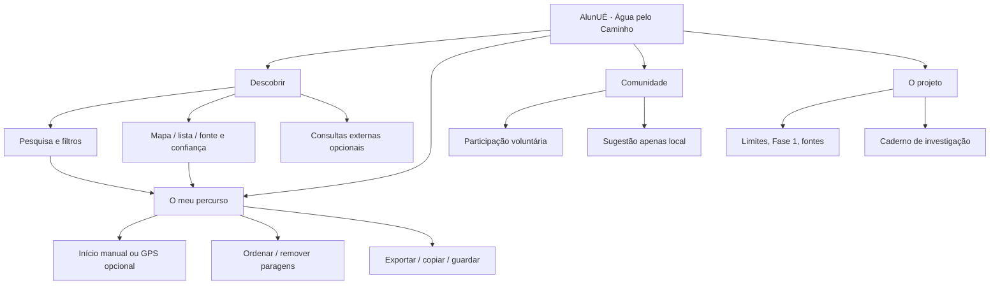

# AlunUÉ · Água pelo Caminho — Fase 2
## Conceção, arquitetura de informação e prototipagem

**Unidade curricular:** INF13186L · Interação Pessoa-Máquina, Universidade de Évora  
**Data do rascunho:** 22 de novembro de 2026  
**Estado:** RASCUNHO PARA REVISÃO PELO ESTUDANTE — **não submetido, não avaliado**.  
**Prazo de referência:** 30 de novembro de 2026 (aviso do docente já registado; verificar hora exata no Moodle antes de submeter).  
**Projeto:** [protótipo AlunUÉ · Água pelo Caminho](https://hostilian.github.io/AlunUE-Agua-Pelo-Caminho/) · [caderno de investigação](https://hostilian.github.io/AlunUE-Agua-Pelo-Caminho/investigacao.html)

> **Nota de origem:** o recurso Moodle de 4/11/2026 intitulado “Fase 2 — Conceção & Prototipagem” (id 30458) apresenta um **exemplo de outra solução AlunUÉ** (horários, cantina e biblioteca), não um novo requisito para substituir o projeto de água. Usam-se apenas categorias metodológicas (cenários, tarefa, arquitetura, ecrãs, protótipos). A redação abaixo é nova e dedicada à solução já estudada. Verificar o enunciado/entrega atuais para critérios específicos.

### 1. Continuidade verificável com a Fase 1

O foco mantém-se em **descobrir locais de água e planear paragens durante deslocações em Évora**, sem afirmar que os 14 candidatos cartográficos são pontos de abastecimento comprovadamente potável, gratuito ou disponível. A aplicação inclui supermercados e locais culturais como extensões opcionais e propostas de lojas voluntárias sem nenhuma adesão confirmada.

A Fase 1 contém **três casos reconstruídos de conversas informais** (C1–C3) e personas provisórias P1–P3. Não representa uma amostra estatística nem entrevistas estruturadas recuperáveis. Os objetivos de interação abaixo são **decisões de conceção**, não resultados de testes já executados.

| Necessidade da Fase 1 | Origem | Resposta de design na Fase 2 | Verificação futura |
|---|---|---|---|
| Conhecer fontes e alternativas económicas em cidade nova | C1 / P1 | Pesquisa, filtros, origem dos dados, estado de verificação explícito | T1: distinguir um candidato de um ponto confirmado |
| Integrar água e descanso numa corrida ou deslocação | C2 / P2 | Adicionar paragens, reordenar, início manual e navegação externa | T2: preservar ordem no percurso exportado |
| Receber novidades quando houver serviço | C3 / P3 | Informação de projeto e proposta de adesão; **sem envios automáticos** | Entrevista neutra sobre canal/consentimento antes de implementar |
| Evitar depender de localização | Hipótese de design / privacidade | Seleção de início manual, centro ou zona CLV | T3: concluir percurso após negar GPS |
| Não confundir dados antigos com garantia atual | Risco de fiabilidade conhecido | Etiquetas “Demonstração” / “Por verificar”; dados de cache datados e erros visíveis | T4: reconhecer uma falha simulada |

**Decisão de âmbito:** não acrescentar pagamento, reservas de cantina, biometria, notificações push, parceiras fictícias ou um sistema de contas. Essas funcionalidades pertencem ao exemplo AlunUÉ, não às necessidades demonstradas neste módulo.

### 2. Cenários de utilização propostos

**U1 — Descoberta num intervalo entre aulas (P1).** Um estudante recém-chegado está na zona central de Évora, sem conhecer os locais de água. Abre “Descobrir”, procura água, consulta a fonte e verifica que um candidato OSM ainda não tem potabilidade nem disponibilidade comprovadas. Decide continuar a procurar em vez de depender dessa localização. **Critério:** conseguir identificar a incerteza sem ajuda.

**U2 — Percurso com paragens (P2).** Uma pessoa planeia uma saída de corrida e pretende incluir água e uma paragem cultural. No **modo de demonstração claramente identificado**, escolhe um início manual, adiciona duas paragens fictícias, reordena e exporta o itinerário pedonal. Não é convidada a visitar fisicamente os locais simulados. **Critério:** todas as paragens permanecem na ordem escolhida, mesmo quando a exportação é dividida em partes.

**U3 — Sem GPS ou rede (caso de falha).** O navegador recusa a localização ou a API externa está indisponível. O estudante mantém a pesquisa e a lista local, recebe uma mensagem que distingue dados atuais dos guardados, e pode copiar ou guardar a descrição do percurso. **Critério:** a aplicação não declara que consultou novas fontes quando operou com dados antigos.

**U4 — Sugerir melhoria (P3, ainda por validar).** Uma pessoa encontra informação incompleta e guarda uma sugestão local. A interface explica que guardar um rascunho **não contacta lojas nem publica alterações**. **Critério:** a pessoa consegue repetir corretamente onde os dados foram guardados e que nenhum envio ocorreu.

### 3. Cenário de tarefa prioritário

**Tarefa T2 — Montar e exportar um percurso demonstrativo**

1. Abrir **Descobrir** e ativar **Demonstração**, mantendo o aviso de locais fictícios.
2. Selecionar um cartão elegível, escolher **Adicionar ao percurso**; repetir para a segunda paragem.
3. Abrir **O meu percurso** e definir início (“Centro de Évora”, “Zona do CLV” ou coordenadas manuais).
4. Alterar a ordem com **↑ Antes** / **↓ Depois**.
5. Escolher **Abrir indicações pedonais** ou **Copiar itinerário** / **Guardar em texto**.
6. Confirmar nomes e ordem; se o serviço externo falhar, usar a alternativa textual.

**Desvios:** sem locais elegíveis → explicar porquê; coordenadas inválidas → pedir correção; geolocalização negada → manter início manual; rede indisponível → não apresentar mapa online como disponível; sugestão de loja não verificada → não apresentar como parceria.

**Meta experimental, ainda não medida:** concluir a sequência sem ajuda numa sessão de usabilidade. Não impor um limite artificial de “três toques” a toda a tarefa, pois isso é um exemplo de outra aplicação e este fluxo é necessariamente composto.

### 4. Arquitetura de informação — elementos já existentes

**Os quatro separadores** correspondem aos links `#discover`, `#journey`, `#community` e `#project` da aplicação existente (`dist/index.html`); não são ecrãs fictícios de uma futura app. O mapa é disponibilizado sob pedido, mantendo alternativa estática. O caderno de investigação `dist/investigacao.html` é uma página distinta, com recolha voluntária e sem participantes pré-carregados.

### 5. Especificação dos ecrãs reais

| Ecrã | Componentes existentes | Ação principal | Estado de erro / acessibilidade | Captura necessária |
|---|---|---|---|---|
| **Descobrir** | Campo de procura, filtros água/supermercado/cultura/lojas, selector de confiança, cartões, mapa Leaflet, aviso de demonstração | Identificar opção e consultar fonte | Lista vazia explicada; mapa estático alternativo; foco/teclado | Screenshot mobile e desktop |
| **O meu percurso** | Origem manual/Centro/CLV/GPS opcional, lista de paragens, botões subir/descer, exportação Google Maps e texto | Preparar itinerário mantendo ordem | Rejeição de coordenadas inválidas; exportação em partes; texto alternativo | Percurso com duas paragens fictícias |
| **Comunidade** | Informação de proposta voluntária, formulário de sugestão, eliminação de dados | Guardar rascunho local | Nenhuma empresa contactada; confirmação antes de eliminar | Estado inicial e confirmação |
| **O projeto** | Método, riscos, fontes, relatório da Fase 1, investigação | Distinguir prova, hipótese e demonstração | Links com atribuição; linguagem clara | Página de limites |
| **Investigar** | Consentimento, perguntas antes de demonstrar produto, tarefas observáveis, SUS, exportação local | Preparar sessão **real** | Não guardar sem consentimento; não preencher respostas inexistentes | Formulário vazio |

**Fidelidade:** o protótipo atual é interativo (não apenas wireframes). Para apresentar evolução de baixa/média fidelidade, podem ser reutilizadas capturas estáticas e fluxogramas do próprio produto com rótulo “protótipo conceptual” e sem simular resultados de participantes.

### 6. Critérios de usabilidade propostos

| Dimensão | Indicador a observar | Método | Estado |
|---|---|---|---|
| Eficácia | Tarefa concluída, com ajuda ou não concluída | Observação por tarefa | **Não medido** |
| Eficiência | Tempo medido por tarefa, número de tentativas e desvios | Cronómetro + notas | **Não medido** |
| Aprendizagem | Sucesso na primeira tarefa e compreensão de confiança | Observação + pergunta de seguimento | **Não medido** |
| Gestão de erros | Recuperar de falta de GPS/rede e reconhecer dados antigos | Falha deliberada **anunciada** | **Não medido** |
| Satisfação | Questionário SUS (dez itens, pontuação apenas para resposta completa) | Protocolo com fonte publicada | **Não medido** |
| Acessibilidade | Navegação por teclado, foco, contraste, mobile e TalkBack Android | Verificação manual | **Parcial / não certificado** |

**Protocolo já preparado e reutilizado:** [docs/usability-protocol-PT.md](usability-protocol-PT.md), com seis tarefas, consentimento e cálculo SUS; [investigacao.html](https://hostilian.github.io/AlunUE-Agua-Pelo-Caminho/investigacao.html) permite o registo local. Os testes automatizados do código verificam contratos e condições de falha, **não substituem testes com pessoas**. Recrutar cinco estudantes reais e distintos da UÉ conforme a regra de avaliação final arquivada; a fase exata em que são exigidos deve ser confirmada no enunciado atual. Não inventar sessões, percentagens, tempos, participantes ou resultados.

### 7. Matriz de rastreabilidade

| Necessidade | Interface | Tarefa / teste | Evidência atual |
|---|---|---|---|
| Localizar candidatos | Descobrir, Leaflet, lista | U1 / T1 | App + lista OSM com 14 candidatos |
| Planear paragens | O meu percurso | U2 / T2 | Código + testes de preservação de ordem |
| Início sem GPS | Centro/CLV/manual | U3 / T3 | Controlo implementado |
| Entender dados não verificados | Etiquetas/fonte/limites | U1 / T1 | Fonte e status no cartão |
| Recuperar de APIs falhadas | Estado/cache/exportação | U3 / T4 | Fallback projetado e contratos testados |
| Participação voluntária | Comunidade e pesquisa | U4 / T6 | Rascunho local; nenhuma adesão |
| Obter avaliação humana | Investigação | Testes reais + SUS | Instrumento pronto; **sem sessões** |

### 8. O que falta até 30 de novembro

| Entrega / verificação | Estado em 22/11 | Dependência |
|---|---|---|
| Confirmar enunciado atual, formato, rubrica e hora de fecho no Moodle | **PENDENTE** | Fonte institucional |
| Rever e personalizar este relatório com interpretação original do estudante | **PENDENTE** | Autor |
| Capturas reais de cinco ecrãs, incluindo um percurso demonstrativo | **PENDENTE** | Browser/telemóvel |
| Adicionar wireflows anotados usando componentes existentes | **PENDENTE** | Capturas / desenho |
| Fazer revisão heurística adicional por pessoa independente | **PENDENTE** | Revisor humano |
| Realizar testes com participantes **se exigidos já na Fase 2** | **POR CONFIRMAR** | Regras + consentimento |
| Compilar e rever PDF final | **PENDENTE** | Relatório/capturas |
| Submeter no Moodle e conservar recibo | **NÃO SUBMETIDO POR ESTE PROCESSO** | Decisão e ação do estudante |

### 9. Referências existentes e integridade

- [Relatório da Fase 1](Relatorio_Fase1_PT.md): casos reconstruídos, personas, mapa de jornada e HTA, com limitações.
- [Decisões do projeto](decision-log.md), [cobertura de requisitos](requirements-coverage.md) e [protocolo de avaliação](usability-protocol-PT.md).
- [Recurso HCI Fase 2 — descrição no Moodle](https://www.moodle.uevora.pt/2627/mod/resource/view.php?id=30458), cópia privada datada de 4/11; o conteúdo AlunUÉ de horários/cantina serve como **referência estrutural**, não como trabalho deste projeto.
- [FUC oficial INF13186L](https://www.uevora.pt/estudar/cursos/licenciaturas?cod=L227&uc=INF13186L&v=plano-estudos): componente prática avaliada em várias entregas durante o período letivo.
- [SUS português](https://doi.org/10.1016/j.procs.2015.09.273) e [Leaflet](https://leafletjs.com/) sob licença BSD-2-Clause, com cópia local em `dist/vendor/leaflet/`.
- O código/protótipo e os registos de fontes são do projeto **Água pelo Caminho**. O texto aqui é um material de trabalho; precisa de revisão crítica e interpretação do estudante antes de avaliação. Nenhum envio ou partilha externa foi efetuado.
