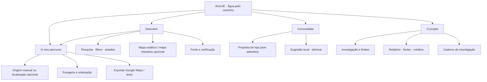
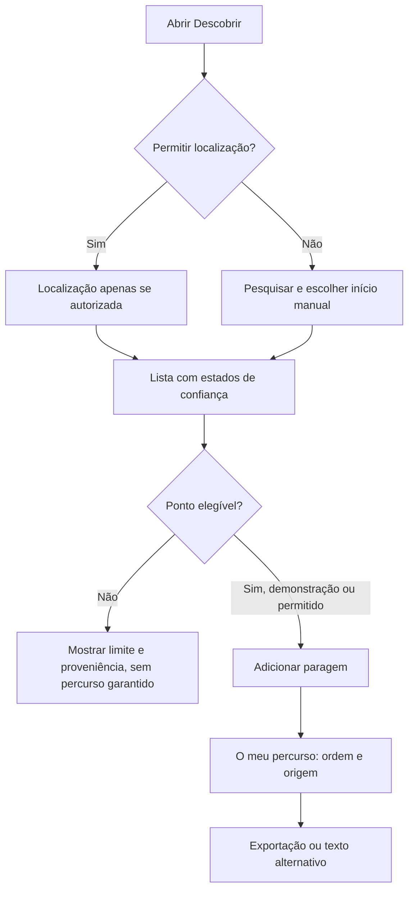

# AlunUÉ — Fase 2: cenários, estrutura de interação e desenho da interface

**Estado:** rascunho para revisão do autor; **não submetido ao Moodle** e **não validado pelo docente**.
**Disciplina:** Interação Pessoa–Máquina, Universidade de Évora.
**Base de implementação:** [aplicação AlunUÉ](../dist/index.html) e [relatório de investigação da Fase 1](Relatorio_Fase1_PT.md).
**Âmbito:** água e percursos em Évora; supermercados, cultura e lojas como extensões opcionais.

## 1. Objetivo e integridade da evidência

Pretende-se apoiar um estudante que procura água, verifica **a qualidade da informação disponível** e planeia paragens sem ceder a localização. Não existe inventário confirmado de água potável e gratuita, nem lojas aderentes. Os 14 candidatos OSM **não** estão individualmente verificados. A demonstração usa locais fictícios e identificados; pode simular o fluxo de planeamento, **não** indicar abastecimento real.

As três personas P1–P3 seguem os casos C1–C3 do relatório anterior. São **perfis de desenho provisórios**, não pessoas adicionais entrevistadas, resultados representativos ou testes de usabilidade executados. Este documento apresenta decisões de design e cenários **propostos**.

## 2. Requisitos e rastreabilidade

| Objetivo | Evidência disponível | Decisão de interface | Critério observável |
| --- | --- | --- | --- |
| R1. Descobrir água sem conhecer a cidade | C1: dificuldade recordada em encontrar fontes | Secção **Descobrir**, lista, pesquisa e mapa opcional | Encontrar candidato e abrir origem/estado sem partilhar GPS |
| R2. Perceber confiança e limitações | 14 candidatos cartográficos; zero verificações individuais independentes | Estados **por verificar**, **demonstração** e **referência**; fonte/data quando existente | Distinguir um candidato de uma fonte confirmada |
| R3. Planear uma deslocação | Jornada proposta da Fase 1; não observada | **O meu percurso**, origem manual, paragens ordenáveis e exportação | Definir início, duas paragens de demonstração e rever ordem |
| R4. Lidar com serviços externos indisponíveis | Limitação técnica prevista, não incidente observado | Mensagem de erro ou cache datada; alternativa textual | Identificar o que não carregou e que dados continuam disponíveis |
| R5. Considerar compras e descoberta | C1: opções económicas percebidas; extensões do autor | Filtros de supermercados e locais de interesse | Adicionar/remover uma extensão sem a tornar obrigatória |
| R6. Evitar adesão comercial inventada | Nenhuma loja confirmada | **Comunidade**, proposta local e sem envio automático | Guardar um rascunho sem o confundir com parceria |
| R7. Respeitar privacidade e acessibilidade | Necessidades de conceção, não auditoria humana concluída | Início manual, navegação por teclado, contraste e alternativas | Executar a tarefa sem GPS; verificar foco e erros |
| R8. Avaliar o desenho de forma verificável | Protocolo de usabilidade preparado | Caderno local de investigação e seis tarefas | Guardar apenas sessões reais e consentidas, nunca inventar dados |

**Nota:** os códigos R1–R8 são índices desta matriz para a Fase 2; consultar o relatório da Fase 1 e a [cobertura de requisitos](requirements-coverage.md) para comparar com os códigos anteriores, sem presumir equivalência literal.

## 3. Personas de referência e cenários de tarefa

### Cenário S1 — Encontrar água numa cidade pouco conhecida (P1 / C1)

**Contexto proposto:** um estudante recém-chegado tem uma garrafa vazia e quer avaliar opções de água sem divulgar a posição.
**Objetivo:** encontrar informação com proveniência e limites claros, mesmo que a fonte não esteja confirmada.

1. Abre **Descobrir** e recusa ou ignora **Usar a minha localização**.
2. Pesquisa “água” ou escolhe o filtro **Água**.
3. Compara os cartões e lê o estado **por verificar**, a origem e a data, se disponível.
4. Abre um candidato no mapa ou na lista; procura informações de acesso e potabilidade.
5. Se não há ponto verificado, a interface **não promete reabastecimento**; pode ativar a demonstração apenas para testar o planeamento.

**Falha a evitar:** interpretar um símbolo cartográfico ou uma coordenada como água potável, gratuita e disponível.
**Condição de sucesso de avaliação:** identifica corretamente que um candidato não é uma confirmação.

### Cenário S2 — Planear paragens para corrida ou caminhada (P2 / C2)

**Contexto proposto:** a pessoa quer ensaiar um percurso com duas paragens, sem assumir que o percurso foi calculado pelas ruas.

1. Ativa **Demonstração**, com aviso visível de dados fictícios.
2. Escolhe **O meu percurso** e define o início pelo centro, zona do CLV ou coordenadas manuais.
3. Adiciona duas paragens elegíveis de demonstração em **Descobrir**.
4. Revê a ordem manual e compara com **Mais perto primeiro** (estimativa em linha reta).
5. Exporta as partes para Google Maps ou guarda uma alternativa legível em texto.

**Falha a evitar:** afirmar que a estimativa de proximidade equivale ao menor percurso pedonal ou que as paragens fictícias existem.
**Condição de sucesso:** o itinerário e a ordem escolhida persistem no texto/exportação.

### Cenário S3 — Descobertas opcionais (P1 / extensão de âmbito)

1. Filtra **Supermercados** ou **Locais de interesse**.
2. Inspeciona nome, fonte e restrições; os preços e horários podem ser desconhecidos.
3. Adiciona apenas um local elegível à lista de paragens.
4. Remove-o sem perder as paragens anteriores.

**Condição de sucesso:** a extensão é voluntária e não altera o objetivo central de água.

### Cenário S4 — API indisponível e informação antiga (cenário de teste técnico)

1. Reproduz uma falha de serviço num ambiente de teste, com a condição registada.
2. Lê **api-status**, identifica a indisponibilidade e distingue dados guardados de consulta atual.
3. Usa informação local ou **Guardar em texto** sem anunciar sucesso da consulta.
4. Reabre quando existir rede e verifica explicitamente a data dos dados.

**Condição de sucesso:** não confunde cache com verificação atual. Esta sequência é proposta para teste, não uma falha real observada.

### Cenário S5 — Sugerir uma loja sem a declarar aderente (P3 / C3 e extensão)

1. Abre **Comunidade**; lê que nenhuma loja aderiu.
2. Preenche **Guardar uma sugestão** e observa a confirmação de armazenamento **local**.
3. Verifica que nenhuma loja foi adicionada aos locais confirmados e que nenhum contacto foi enviado.
4. Pode apagar sugestões e preferências com confirmação.

**Condição de sucesso:** separa proposta local, contacto voluntário e adesão confirmada.

## 4. Arquitetura de informação



O núcleo da navegação tem quatro secções com rótulos concretos. A origem é definida na secção de percurso; o mapa em Descobrir constitui uma alternativa opcional e não deve bloquear a lista.

## 5. Fluxos de interação e transições de estado



Estados a distinguir: `demo` (fictício e identificável), `candidate` (não verificado), `reference` (local de interesse) e consulta externa com erro ou cache datada. Nenhum estado equivale automaticamente a água potável gratuita.

## 6. Wireframes esquemáticos de baixa fidelidade

### Descobrir · ecrã pequeno

```text
┌────────────────────────────────┐
│ ALUNUÉ ÁGUA                    │
│ Descobrir · Percurso · ...     │
├────────────────────────────────┤
│ Enche a garrafa.               │
│ Descobre o caminho.            │
│ [Localização] [Demonstração]    │
│ Informação: demo / verificação │
├────────────────────────────────┤
│ [Mapa estático]                │
│ [Abrir mapa interativo]        │
├────────────────────────────────┤
│ [Todos][Água][Superm.][Vistas] │
│ [Procurar local___________]    │
│ [Estado de confiança v]        │
├────────────────────────────────┤
│ CANDIDATO · POR VERIFICAR      │
│ Nome, acesso e fonte           │
│ [Fonte e verificação]          │
│ [Ação disponível ou impedida]  │
└────────────────────────────────┘
```

### O meu percurso · ecrã pequeno

```text
┌────────────────────────────────┐
│ O meu percurso, a tua ordem.   │
│ Aviso: demonstração fictícia   │
├────────────────────────────────┤
│ 1. Início                      │
│ [Centro / CLV / GPS / manual v] │
│ [Latitude] [Longitude]         │
│ [Ordem manual v]               │
├────────────────────────────────┤
│ 2. Paragens                    │
│ (1) Local de demonstração A    │
│ (2) Local de demonstração B    │
│ [Remover] [Reordenar]          │
├────────────────────────────────┤
│ 3. Levar o plano               │
│ [Abrir Google Maps]            │
│ [Copiar] [Partilhar] [Texto]   │
│ Dados e percurso não garantidos│
└────────────────────────────────┘
```

São **wireframes analíticos**, não capturas de uma sessão de utilizador nem novos ecrãs implementados. O protótipo existente, nos seus estados reais, pode ser revisto em [dist/index.html](../dist/index.html) e [dist/investigacao.html](../dist/investigacao.html).

## 7. Decisões, alternativas e justificação

| Decisão | Alternativa rejeitada ou adiada | Justificação |
| --- | --- | --- |
| Lista + mapa opcional | Depender exclusivamente de GPS/mapa | Acesso sem permissão, maior robustez e navegação por teclado |
| Estados de confiança explícitos | Mostrar todos os pinos como “fontes” | Evita converter geodados em alegações de água segura |
| Exportar para Google Maps e texto | Motor de rotas próprio | Reutilização e fallback; os links não são uma garantia de distância/segurança |
| Rascunho local de sugestão | Enviar a lojas automaticamente | Consentimento e ausência de adesões confirmadas |
| Pesquisa antes de demonstração | Criar entrevistas/resultados fictícios | Integridade académica; personas são hipóteses a validar |
| Protocolo de seis tarefas e SUS | Afirmar usabilidade por testes unitários | Testes automatizados verificam comportamento técnico, não utilizadores |

## 8. Avaliação planeada — nenhuma sessão atribuída

Antes da Fase 3: fixar versão e dispositivo, realizar um piloto, obter consentimento e observar utilizadores reais sem lhes indicar botões. O [protocolo existente](usability-protocol-PT.md) contempla seis tarefas (T1–T6), falhas simuladas declaradas, métricas com denominadores, SUS de dez itens e análise de resultados em falta. O [caderno local](../dist/investigacao.html) começa sem sessões nem dados pré-carregados.

**Ainda por realizar, sem alegações de conclusão:** observações presenciais, revisão por outros estudantes, validação em telemóvel/TalkBack, verificação de água no terreno e cinco estudantes distintos para o ciclo final, conforme o protocolo registado.

## 9. Revisão pré-submissão (pendente)

- [x] Cenários de desenho alinhados com os relatos C1–C3, sem novas entrevistas inventadas.
- [x] Navegação, estrutura de informação, fluxos e wireframes documentados.
- [x] Ligações ao protótipo e limitações operacionais descritas.
- [ ] Confirmar o **enunciado completo da Fase 2**, formato, número de páginas, critérios, trabalho individual/grupo e evidências de avaliação requeridas.
- [ ] Verificar visualmente cada wireframe contra a versão congelada do protótipo e anexar capturas reais, se exigidas.
- [ ] Obter revisão humana/feedback documentado, se exigido; não preencher observações fictícias.
- [ ] Produzir o ficheiro final requerido e **submeter manualmente no Moodle**, com comprovativo.
- [ ] Ler a nota/feedback antes de afirmar aprovação.

**Fontes:** [relatório Fase 1](Relatorio_Fase1_PT.md) · [evidência C1–C3](evidence-cases-PT.md) · [requisitos](requirements-coverage.md) · [protocolo de usabilidade](usability-protocol-PT.md) · [aplicação](../dist/index.html). A versão do professor tem precedência sobre este rascunho.
